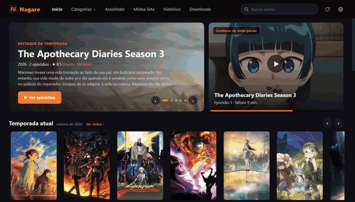
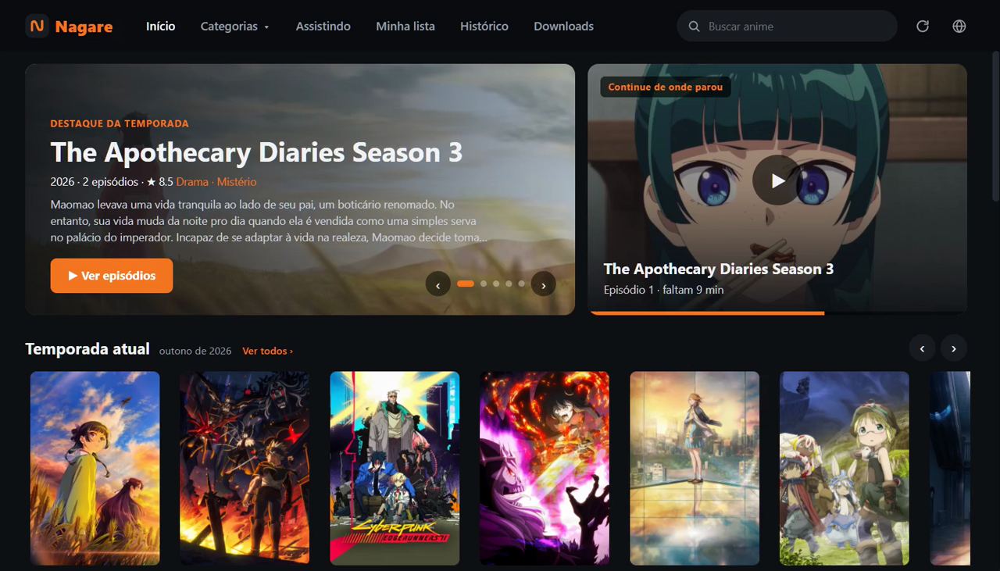
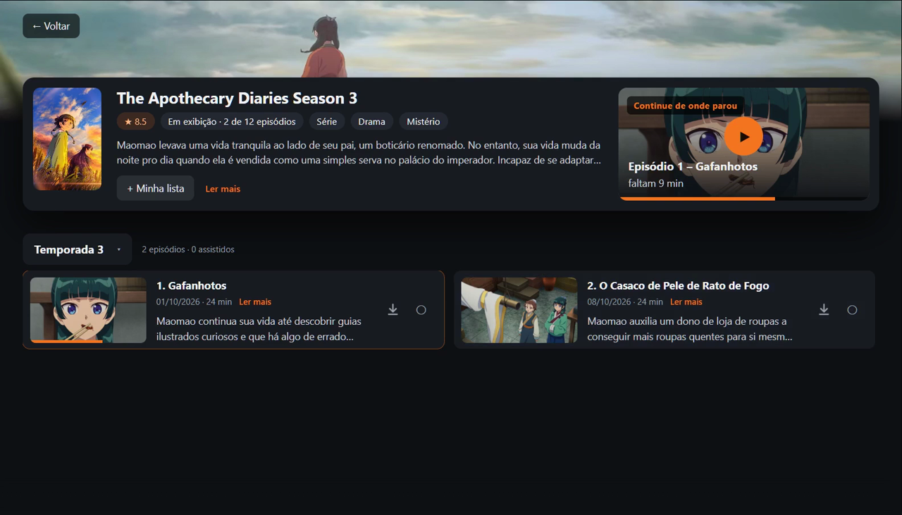
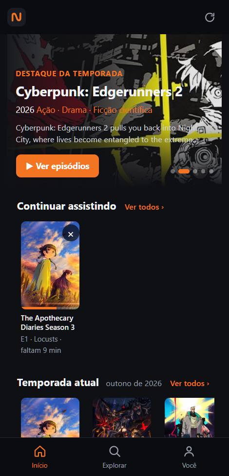
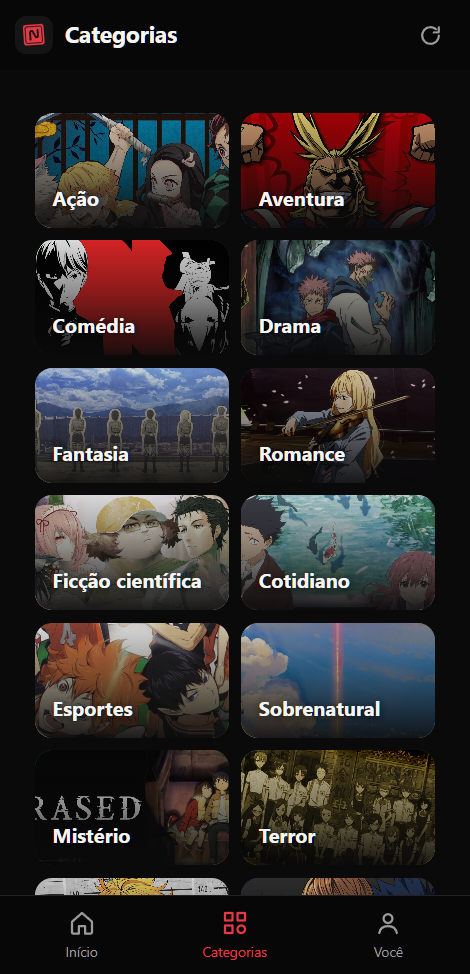
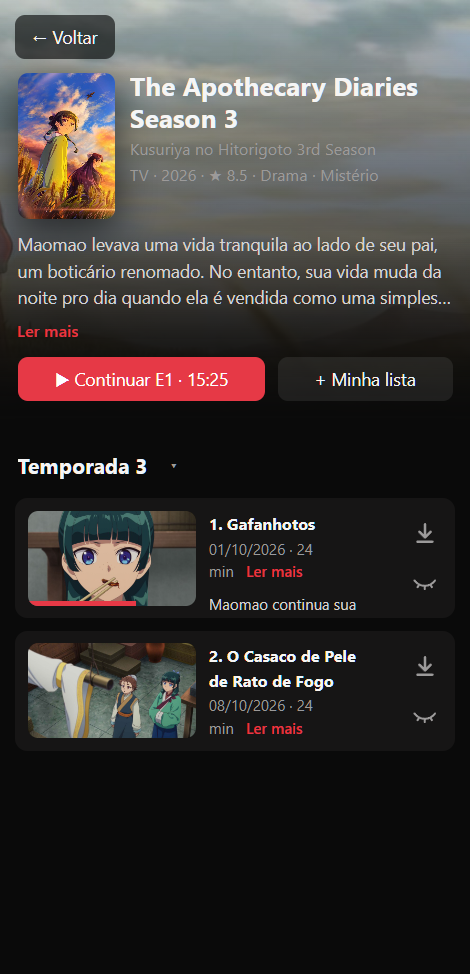

# Nagare

**Seu anime, no computador e no celular.**

Catálogo completo, legendas em português, continuar de onde parou 
e download de episódios para ver sem internet.

 

&nbsp;&nbsp;

Versão 0.2.1 · Windows 10 ou 11 · Android 8 ou mais novo · grátis

  

O Nagare funcionando no computador · <a href="media/nagare-pc.mp4">abrir o vídeo em tela cheia</a>

 

## ✨ O que o Nagare faz

| | |
|---|---|
| 🎬 **Catálogo sempre atualizado** | Os animes da temporada, os mais assistidos e uma busca por nome ou categoria. |
| 💬 **Legendas em português** | Quando existe em português, é ela que abre. Se não, espanhol ou inglês. |
| ⏯️ **Continuar de onde parou** | Fechou no meio? O episódio volta no mesmo ponto, no topo da tela inicial. |
| ⬇️ **Download de episódios** | Baixe quantos quiser e assista depois, sem internet. |
| 📚 **Sua lista e seu histórico** | Guarde o que quer ver e encontre o que já viu. |
| 🗂️ **Temporadas, filmes e especiais** | Tudo de cada anime organizado num menu só. |

 

## 🖥️ No computador

<table>
  <tr>
    <td></td>
    <td></td>
  </tr>
  <tr>
    <td align="center">Tela inicial</td>
    <td align="center">Página do anime</td>
  </tr>
</table>

## 📱 No celular

  
  &nbsp;&nbsp;
  
  &nbsp;&nbsp;
  

 

## 🚀 Como instalar

### No computador (Windows)

1. Clique em **Baixar para Windows**, lá em cima, e abra o arquivo que baixou.
2. Vai aparecer uma tela azul escrito **"O Windows protegeu o computador"**. Pode ficar tranquilo: ela aparece para todo programa novo que ainda não tem assinatura digital, e não quer dizer que há vírus.
3. Clique em **Mais informações** e depois em **Executar assim mesmo**.
4. Avance até o fim do instalador. Pronto: o Nagare está na área de trabalho e no menu Iniciar.

### No celular (Android)

1. No celular, toque em **Baixar para Android**, lá em cima.
2. Abra o arquivo baixado. O Android vai pedir permissão para **instalar apps desconhecidos**: toque em **Configurações**, ative para o seu navegador e volte.
3. Toque em **Instalar**. Se o Play Protect avisar que não conhece o app, escolha **Instalar mesmo assim**.

 

## 🍿 Como usar

1. **Escolha um anime** no catálogo ou procure pelo nome.
2. **Toque no episódio.** Os lançamentos abrem em poucos segundos; animes antigos podem levar um pouco mais.
3. **Parou no meio?** Ele fica esperando em *Continuar assistindo*.
4. **Vai ficar sem internet?** Toque na **seta** ao lado do episódio para baixar. Tudo que você baixar aparece em *Downloads*.

 

## ❓ Dúvidas comuns

<b>Como eu atualizo o Nagare?</b>

 
Ele se atualiza sozinho. No computador, a versão nova é baixada enquanto você usa e aparece um aviso com o botão <b>Reiniciar</b>. No celular, aparece o aviso <b>Nova versão</b>: toque em <b>Atualizar</b> e depois em <b>Instalar</b>. Sua lista, seu histórico e seus downloads continuam lá.
  
Isso vale a partir da versão 0.2.1. Se o seu Nagare é mais antigo, baixe a versão nova aqui na página uma última vez. No celular, desinstale o antigo antes de instalar.

<b>O episódio não abre ou diz que não está disponível</b>

 
Alguns animes antigos ou pouco conhecidos não têm fonte no momento. Tente outro episódio ou volte mais tarde.

<b>A legenda não veio em português</b>

 
O Nagare procura primeiro em português, depois em espanhol e em inglês. Se o episódio tiver mais de uma legenda, dá para trocar no botão <b>Legendas</b> do player. No computador você também pode usar a sua: em <b>Legendas › Adicionar legenda do computador</b>, escolha um arquivo <code>.srt</code> ou <code>.ass</code>. Se ela ficar fora do tempo, toque em <b>Adiantada</b> ou <b>Atrasada</b>, no mesmo menu, conforme você estiver vendo: o Nagare corrige meio segundo por toque.

<b>As sinopses e os nomes dos episódios estão em inglês</b>

 
Os textos em português vêm do site TMDB, que pede uma chave gratuita por pessoa. Crie uma conta em <a href="https://www.themoviedb.org/settings/api">themoviedb.org</a>, copie a <b>Chave da API</b> e cole no Nagare: no computador, no <b>ícone do globo</b> no alto da tela; no celular, em <b>Você › Ajustes</b>. Faz uma vez só. As legendas dos episódios não dependem disso.

<b>Onde ficam os episódios que eu baixei no computador?</b>

 
Na pasta <b>Vídeos › Nagare</b>, separados por anime.

<b>O Windows ou o antivírus reclamou do instalador</b>

 
O Nagare é novo e ainda não tem assinatura digital, por isso o Windows mostra o aviso da tela azul. Clique em <b>Mais informações › Executar assim mesmo</b>.

 

## 💬 Achou um problema ou tem uma ideia?

Conte para a gente em [**Issues**](https://github.com/car-junior/nagare-releases/issues). Ajuda muito dizer qual anime e episódio, e se foi no computador ou no celular.

 
Todas as versões ficam em <a href="https://github.com/car-junior/nagare-releases/releases">Releases</a>.

